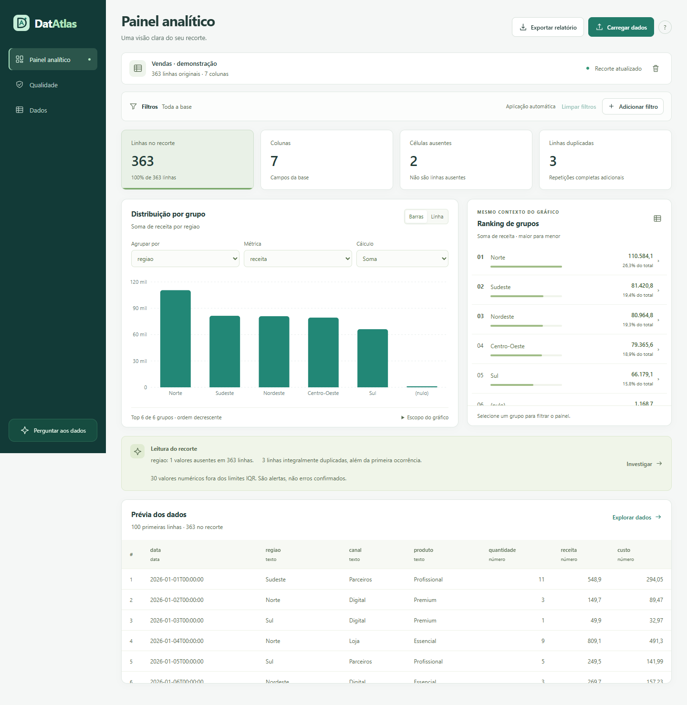

# DatAtlas — análise exploratória, qualidade de dados e IA aplicada

Planilhas podem reunir valores ausentes, duplicatas e medidas que mudam conforme
o recorte analisado. No DatAtlas, desenvolvi um **estudo autoral de análise de
dados** para explorar essas condições e conectar qualidade, estatísticas,
visualização e perguntas com evidências.

O projeto permite conhecer meu raciocínio na preparação e interpretação de dados,
na definição de agregações e no uso de IA com cálculos verificáveis. A interface
torna essas escolhas visíveis; código, testes e demonstração sintética permitem
aprofundar a avaliação.

[Estudo de caso e decisões](docs/ESTUDO_DE_CASO.md) ·
[Demonstração visual](https://datatlas.inteligencia-operacional.duckdns.org/) ·
[Testes automáticos](https://github.com/GabrielTIAlef/DatAtlas/actions/workflows/validate.yml)

## Problema proposto

O cenário é a exploração inicial de uma planilha, antes de assumir que seus
totais e categorias já podem sustentar uma decisão. As perguntas que orientam
o trabalho são:

- Quais campos estão ausentes, repetidos ou fora do comportamento mais frequente?
- Como comparar grupos sem mudar o denominador ou esconder categorias fora do ranking?
- Como garantir que um filtro aplicado ao painel também apareça na pergunta e no relatório?
- Como usar linguagem natural para escolher um cálculo sem delegar os valores ao modelo?

Trata-se de um cenário criado para demonstrar competências, com dados sintéticos.
Não representa contratação por um cliente ou impacto medido em uma empresa.

## Minha atuação e decisões

Construí o fluxo de leitura CSV/XLSX, validação e análise com Pandas; os contratos
da API; a exploração visual e os filtros; o assistente com operações restritas;
e o relatório do recorte. Os testes verificam a ligação entre essas partes.

| Necessidade analítica | Escolha no projeto | Conhecimento demonstrado |
| --- | --- | --- |
| Compreender a base antes de interpretar totais | Exibir tipos inferidos, nulos, duplicatas, estatísticas e alertas IQR | Análise exploratória e qualidade dos dados |
| Investigar categorias sem perder o contexto | Separar filtros de coluna da seleção visual do gráfico/ranking | Definição de recorte e consistência de indicadores |
| Evitar percentuais enganosos no top 20 | Usar o total de todos os grupos como denominador; restringir percentuais a agregações adequadas | Raciocínio quantitativo e comunicação visual |
| Responder com um número conferível | Gemini escolhe uma operação e um alias; Pandas calcula e devolve evidências | Uso de IA com validação de contrato e rastreabilidade |
| Compartilhar a análise realizada | Recalcular filtros e seleção ao gerar o relatório | Coerência entre exploração e comunicação dos resultados |

Para examinar essas decisões, veja [perfil e agregações](backend/main.py),
[coordenação das consultas](frontend/src/useAnalysis.js),
[gráfico e ranking](frontend/src/ChartPanel.jsx) e
[testes de recorte](tests/test_ranking.py).

## Leitura da demonstração: qualidade antes da conclusão

A base publicada contém **363 linhas sintéticas e sete colunas**, com duas células
ausentes, três linhas integralmente duplicadas além da primeira ocorrência e
um valor de receita de 42.000 inserido deliberadamente como extremo.

| Recorte da amostra | Linhas | Soma da coluna `receita` |
| --- | ---: | ---: |
| Base completa | 363 | 419.683,10 |
| Região Sul | 68 | 66.179,10 |
| Região Sul + canal Digital | 25 | 24.259,80 |

Os valores foram conferidos em [demo/vendas.csv](demo/vendas.csv). Representam
uma coluna do conjunto fictício, sem moeda ou resultado empresarial atribuído.
A soma mantém duplicatas e o valor extremo: identificá-los não autoriza removê-los
sem investigar sua origem. Uma mudança de total após filtrar também não é, por
si só, mudança de desempenho da operação.

O resultado demonstrado é a preservação do recorte entre indicadores, pergunta
e relatório. Outliers são sinais para investigar, não erros automaticamente
confirmados; a análise é descritiva e não estabelece causalidade.

## Evidências para conhecer o trabalho



[Versão móvel](docs/revisao-mobile.png) ·
[Assistente no celular](docs/revisao-assistente-mobile.png) ·
[Exemplo de relatório sintético](docs/exemplo-relatorio.html)

Python 3.12, Pandas, FastAPI, Pydantic, openpyxl e Google Gen AI SDK compõem a
camada de dados/API. React, JavaScript, Vite e Recharts compõem a interface.
pytest, Ruff, ESLint, Playwright e GitHub Actions sustentam a validação.

A documentação registra **49 testes Python e 14 jornadas de navegador** na entrega
publicada. O [CI da versão inspecionada](https://github.com/GabrielTIAlef/DatAtlas/actions/runs/43528744808)
estava aprovado na consulta desta revisão. A execução histórica e seus limites
estão em [VALIDACAO.md](docs/VALIDACAO.md) e [CI.md](docs/CI.md).
Nesta revisão, os 49 testes e as 14 jornadas também passaram localmente, sem
Gemini real; veja [a validação desta etapa](docs/REVISAO_PORTFOLIO.md).

A implantação documentada usa uma VM Oracle existente, com HTTPS e isolamento
por sessão de navegador. Ela é uma evidência de integração, e não o objetivo
central do portfólio. Código e demonstração local não dependem dessa VM.
Consulte [a operação e os limites](docs/ORACLE-DEPLOYMENT.md) para o registro
da implantação; a disponibilidade atual do site não foi retestada nesta revisão.

<details>
<summary>Reproduzir localmente e conhecer as interações</summary>

## Abrir o aplicativo

1. Na pasta do projeto, dê dois cliques em **Iniciar.cmd**.
2. Mantenha a janela aberta e acesse **http://127.0.0.1:8012**.
3. Clique em **Usar demonstração** ou carregue uma planilha sua, preferencialmente anonimizada.
4. Para encerrar, pressione Ctrl+C na janela do servidor.

A interface compilada já está incluída. Não precisa de Node em execução, Docker ou banco de dados. O painel funciona localmente; a IA usa a configuração do Gemini no servidor e dispõe de fallback local. A execução local não exige hospedagem. Instalação de dependências e uso opcional do provedor continuam sujeitos à disponibilidade e às condições dos serviços.

Se o ambiente Python não existir, execute `powershell -NoProfile -ExecutionPolicy Bypass -File .\setup.ps1`. Ele usa o Python 3.12 instalado em `%LOCALAPPDATA%\Programs\Python\Python312`; para outro local use `-PythonExe 'C:\caminho\python.exe'`. Bibliotecas são instaladas somente no ambiente `.venv` do projeto. Para mudar a porta, edite `start.ps1`.

## Fluxo e interações

- **Painel analítico:** indicadores, gráfico, ranking, insights descritivos e prévia dos dados.
- **Qualidade:** tipos inferidos, nulos, únicos, outliers e estatísticas. A quantidade de nulos por coluna permite filtrar as linhas daquela coluna.
- **Dados:** primeiras 100 linhas do recorte, com rolagem interna e cabeçalhos disponíveis.
- **Assistente:** botão flutuante em todas as seções; expande, recolhe e conserva a conversa durante a navegação. As evidências de cada resposta registram o recorte original daquela pergunta. Trocar/excluir o dataset inicia outra conversa.

### Filtros automáticos e seleção visual

Clique em **Adicionar filtro**, escolha a coluna, operador e valor. Não existe botão Aplicar: mudanças válidas são enviadas após uma breve pausa de digitação (240 ms). Filtros se combinam com **E**; até 8 regras de coluna mais uma seleção visual. Cada regra pode ser removida; **Limpar filtros** remove regras e seleção.

Clique em uma barra ou em um item do ranking para filtrar os indicadores, prévia, qualidade, assistente e exportação. Clique no item selecionado novamente ou remova o marcador para desfazer. O ranking oferece a mesma interação por teclado, além dos valores acessíveis sem depender do tooltip.

**Gráfico e ranking mantêm o contexto dos filtros de coluna, excluindo somente a própria seleção visual.** Isso permite trocar de categoria sem limpar tudo. O escopo está indicado na interface. Os outros componentes usam o recorte completo, incluindo a seleção. Não há comparações fictícias com períodos anteriores ou conclusões causais.

O ranking é ordenado do maior para o menor e mostra até 20 grupos. As barras são proporcionais ao maior valor absoluto nesse ranking. Percentuais aparecem apenas para contagem ou soma não negativa, com denominador de todos os grupos do contexto, inclusive os não exibidos. Média, mínimo, máximo ou somas com valores negativos não recebem percentuais de participação. A visualização de linha segue o ranking, não a cronologia.

Durante atualização, os dados anteriores permanecem visíveis, com indicação de que ainda não correspondem à seleção. Respostas antigas são canceladas/ignoradas. A exportação e novas perguntas ficam bloqueadas até que o recorte atual esteja validado. Em caso de erro, os dados não desaparecem; há mensagem e ação de tentar novamente. Erro num novo upload preserva o dataset anterior.

### Relatório

**Exportar relatório** baixa HTML com dataset, data/hora UTC, número de linhas, filtros, seleção, estatísticas, insights e agregações do recorte exportado. Não inclui categorias fora da seleção, embora o gráfico interativo da tela mantenha esse contexto para navegação. O endpoint recalcula o recorte solicitado; não reutiliza números antigos da interface. Abra o HTML no navegador e use Imprimir → Salvar PDF. O relatório ainda não incorpora o gráfico como imagem.

</details>

## Demonstração

`demo/vendas.csv`: 363 linhas sintéticas, 7 colunas, 2 células ausentes, 3 duplicatas completas e um valor extremo deliberado. Não contém dados pessoais reais. Gerador determinístico: `scripts/generate_demo.py` (preserva a base se ela já existir).

Experimente selecionar **Sul** no ranking: 68 linhas e soma de receita de aproximadamente **66.179,10**. O assistente responde “Qual a soma de receita?” com o mesmo valor e as evidências. Combine com `canal = Digital` e confira a mudança coordenada nos componentes. Os cálculos usam ponto flutuante, com arredondamento apenas de exibição; não substituem escrituração contábil.

## Como funciona

```text
React / navegador (assets e gráficos locais)
   → FastAPI em 127.0.0.1:8012
   → validação CSV/XLSX → Pandas em memória
   → filtros de coluna → contexto do gráfico e ranking
   → seleção visual → indicadores, prévia, perguntas e relatório
   → Gemini no envio da pergunta para escolher operação e alias válidos
```

Não foi necessário DuckDB para este volume. Use somente um processo/worker: os datasets estão na memória desse processo. `backend/main.py` preserva os endpoints `/api/status`, `/api/upload`, `/api/demo`, `/api/datasets/{id}/analyze`, `/ask`, `/report` e exclusão. A revisão adiciona `selection` opcional à consulta, `context_chart`, itens tipados e `applied_query` à resposta, mantendo `chart`, `labels`, `values` e os filtros anteriores compatíveis.

`frontend/src` separa gestão de consultas, filtros, tabela, qualidade, gráficos e assistente. `frontend/dist` contém o build pronto. `tests` valida a API; `frontend/e2e` valida fluxos reais no navegador; `docs` reúne decisões, resultados e capturas. Nenhuma credencial é necessária no frontend.

<details>
<summary>Contratos de dados, privacidade, IA e limites de execução</summary>

## Segurança, privacidade e limites

| Recurso | Limite/comportamento |
|---|---|
| Arquivo | 5 MiB, CSV ou XLSX |
| Dataset | 50.000 linhas e 60 colunas |
| Texto | Célula até 2.000 caracteres; cabeçalho único até 100 |
| XLSX | Primeira aba; sem fórmulas/macros; até 30 MiB descompactados e 1.000 entradas ZIP |
| Upload | Um processamento por vez |
| Memória | Até 3 datasets no servidor e 2 por sessão pública; 24 MiB por base e 48 MiB no total; 30 min sem acesso, com limpeza na próxima operação |
| JSON | Até 32 KiB por requisição |
| Pergunta | Até 500 caracteres; uma em envio por vez na interface |

CSV aceita vírgula, ponto e vírgula, tabulação e barra vertical; UTF-8/BOM e fallback Windows-1252. `;` usa vírgula decimal. Campos por linha devem ser consistentes. Datas ISO são reconhecidas; datas brasileiras ambíguas permanecem texto. Tipos são inferidos: identificadores numéricos podem perder zeros à esquerda. Não há editor de tipos ou seletor de aba neste MVP.

Nulos são ignorados nas estatísticas; desvio padrão é amostral. Duplicatas comparam a linha inteira além da primeira ocorrência. Outliers: fora de `Q1 − 1,5 × IQR` e `Q3 + 1,5 × IQR`; não são removidos. Com IQR zero, valores diferentes do intervalo degenerado podem ser marcados. Grupo cuja métrica está inteiramente nula permanece sem valor, inclusive na soma.

O arquivo original nunca é modificado. Não salvamos uploads em disco, nem executamos fórmulas, macros, código Python, SQL ou instruções de células. Textos da interface e relatório são escapados. Host/Origin são validados sem wildcard, e a API escuta somente em localhost. O acesso público usa uma sessão por navegador, em cookie assinado, Secure, HttpOnly, SameSite Strict e restrito ao host. Análise, pergunta, relatório e exclusão conferem o proprietário; conhecer apenas o ID de um dataset não permite acessá-lo. Não há contas, histórico de usuários ou recuperação de sessão. Abas do mesmo perfil de navegador compartilham a sessão; não compartilhar cookies ou perfil com outras pessoas. No modo local, os hosts continuam restritos a localhost.

Exclua o dataset pelo botão da interface para liberar a memória imediatamente. Reiniciar/encerrar o servidor apaga as bases. Recarregar a página perde sua referência na interface; não há persistência ou histórico em disco. O relatório pode conter dados sensíveis. Não há detecção/anonimização automática de PII; revise os dados e exportações antes de compartilhar.

## Gemini e custo

O Gemini é acionado automaticamente ao enviar uma pergunta. Usa o SDK `google-genai`, o modelo `gemini-3.1-flash-lite`, timeout de 15 segundos e uma única tentativa, com configuração própria deste projeto. Não existem checkbox ou confirmação por pergunta. Não há chamadas ao abrir a aplicação ou mudar filtros.

A configuração local usa `GEMINI_KEY_FILE` no `.env` ignorado, apontando para o arquivo de chave informado pelo usuário. A credencial continua nesse arquivo externo; não é copiada para o frontend, repositório ou relatório. Também é possível usar `GEMINI_API_KEY`/`GOOGLE_API_KEY` no ambiente. Se o arquivo estiver inacessível, a configuração estiver desativada ou o provedor falhar, o cálculo local continua disponível.

O arquivo `.env.example` não contém credenciais. Um orçamento local persistente limita a 30 tentativas por dia (`GEMINI_DAILY_LIMIT`); o contador fica em `.local/gemini-quota.sqlite3`, ignorado pelo Git, sem perguntas ou dados. As cotas do Google também se aplicam. Nenhum faturamento, assinatura, recurso de cloud ou aumento de cota foi configurado. As condições do modelo devem ser conferidas pelo titular na [documentação de preços do Google](https://ai.google.dev/gemini-api/docs/pricing#gemini-3.1-flash-lite); o orçamento local limita requisições, não determina nem altera o plano de cobrança da conta.

O provedor recebe somente a pergunta, aliases das colunas numéricas e a contagem de linhas. Não enviamos células, categorias, amostras ou dataset completo. O texto digitado pode conter dados pessoais: revise-o antes de enviar. A ajuda do botão **?** mantém essas informações acessíveis sem ocupar o chat.

A IA retorna somente uma operação permitida e um alias, validados por JSON Schema e Pydantic; os valores finais são calculados pelo Pandas. Não executa código, SQL ou instruções da planilha. Confirme operação, coluna e filtros nas evidências. Perguntas compostas, previsões e inferência causal continuam fora do escopo. A integração foi validada com uma chamada real sobre a demonstração sintética, além de testes simulados para falhas e limites.

</details>

## Desenvolvimento e testes

Python 3.12 e Node 24. As versões de reprodução estão registradas nos lockfiles; a preparação do ambiente instala essas dependências. O navegador dos testes é o Chrome existente; ajuste `CHROME_PATH` se necessário. `requirements-lock.txt` e `frontend/package-lock.json` registram as dependências.

```powershell
.\.venv\Scripts\python.exe -m pip install -r requirements-dev.txt
.\.venv\Scripts\python.exe -m pytest -q
.\.venv\Scripts\python.exe -m ruff check backend tests scripts
.\.venv\Scripts\python.exe -m ruff format --check backend tests scripts
cd frontend
npm ci --no-audit --no-fund
npm run lint
npm run build
# Servidor em outra janela:
npm run test:e2e
```

Se `npm` não estiver disponível no PATH mas `node` estiver, as ferramentas já instaladas também funcionam diretamente: `node node_modules/eslint/bin/eslint.js .`, `node node_modules/vite/bin/vite.js build`, `node node_modules/@playwright/test/cli.js test`. Node não é necessário para uso cotidiano da interface pronta.

Consulte `docs/REVISAO-UX.md` e `docs/VALIDACAO.md` para os resultados locais originais e `docs/ORACLE-DEPLOYMENT.md` para os testes da implantação. A revisão pública passou em **49 testes pytest** e **14 jornadas Playwright** pelo domínio real, sem login. O workflow do GitHub também testa API/segurança, Ruff, frontend e navegador sem chave Gemini: veja [CI](docs/CI.md). O DatAtlas usa somente a VM Oracle existente, sem novos serviços pagos.

## Limites e aprofundamentos analíticos

- Tipos são inferidos; identificadores numéricos podem perder zeros iniciais.
  Editor de tipos e contrato explícito por coluna seriam aprofundamentos úteis.
- Datas e valores de planilhas exigem interpretação da origem. A linha do gráfico
  segue o ranking atual e não deve ser apresentada como série cronológica.
- Correlação, previsão, inferência causal e perguntas por grupos não fazem parte
  das operações implementadas. O assistente não substitui investigação analítica.
- Os dados ficam temporariamente em memória de um processo, com limites definidos;
  isso é suficiente para o escopo demonstrativo, sem alegação de escala produtiva.
- O modo público já verifica propriedade por sessão. Autenticação de contas,
  recuperação de dados e governança para dados reais são outro escopo.

Essas escolhas delimitam o que o projeto demonstra e fornecem temas para discussão
de metodologia, qualidade e arquitetura em uma avaliação técnica.
